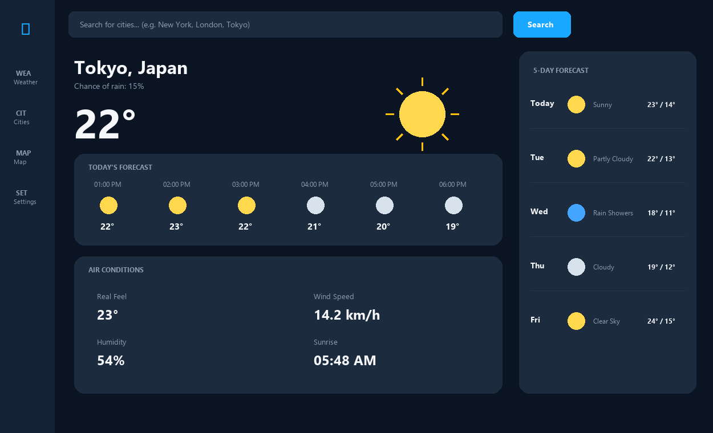
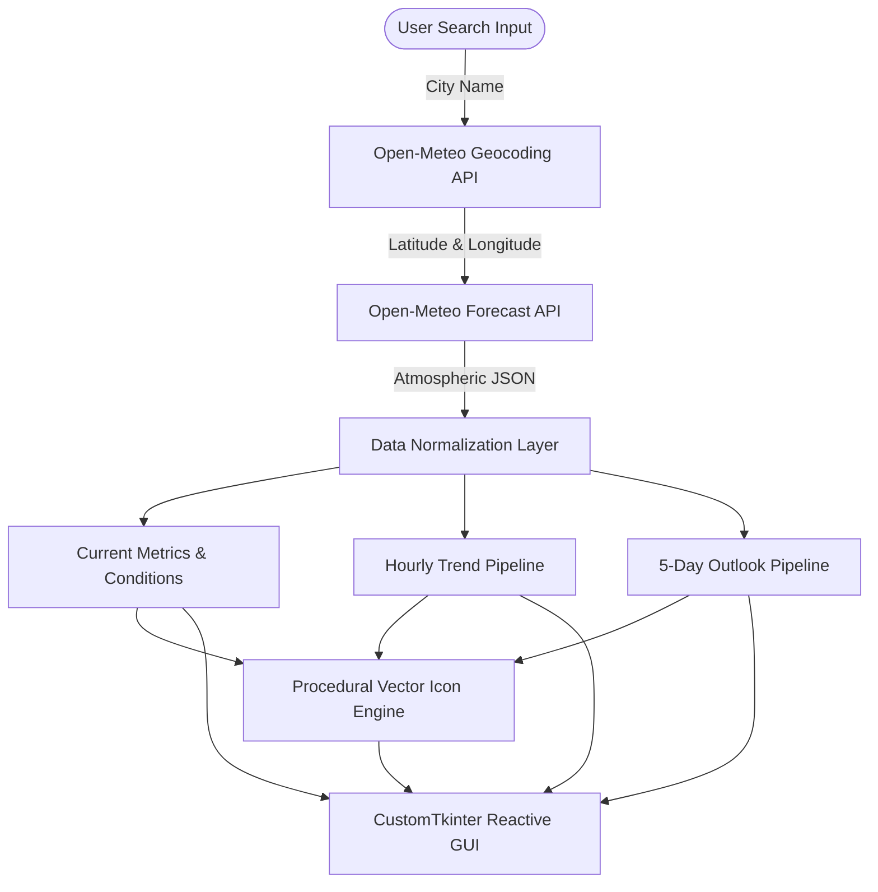

# ☁️ Weatherly — Modern Desktop Weather Dashboard

[](https://python.org)
[](https://github.com/TomSchimansky/CustomTkinter)
[](https://open-meteo.com)
[](https://github.com/YusraShehzadi/Weatherly)
[](https://github.com/YusraShehzadi)

A desktop weather intelligence dashboard with a modern dark theme, real-time geocoding, procedural vector weather icons, hourly forecasts, and 5-day meteorological projections.

---

## 📸 Interface Preview



---

## ✨ Key Features

- **🔍 Smart Global Geocoding:** Search and instantly resolve any city worldwide with automated coordinate and country lookup.
- **🎨 Procedural Vector Graphics Engine:** Custom anti-aliased weather icons dynamically drawn at runtime using Pillow (Clear Sun, Clouds, Showers, Snow, Thunderstorms, Fog).
- **⏱️ Hourly Forecast Timeline:** 6-hour dynamic breakdown showing temperature trends and atmospheric variations.
- **🌡️ In-Depth Atmospheric Conditions:**
  - **Real Feel:** Apparent human-comfort temperature index.
  - **Wind Speed:** Surface wind velocity in km/h.
  - **Humidity:** Relative atmospheric moisture levels.
  - **Sunrise & Sunset:** Localized astronomical event timings.
- **📅 5-Day Extended Forecast:** High/low temperature trends and projected weather states.
- **🌙 Fluent Dark Dashboard:** Designed with modern UI principles, soft card elevation, and visual hierarchy.

---

## 🏛️ System Architecture



---

## 🚀 How to Run & Evaluate

> [!NOTE]  
> **Source Protection Notice:**  
> The core GUI application engine is packaged as a pre-compiled standalone binary to protect proprietary code and algorithmic designs. Evaluators, recruiters, and reviewers can test the complete, fully functional application using either option below.

### Option 1: Run the Standalone Desktop Application (Recommended)
No Python installation or external dependencies are required.

1. Navigate to the **[Releases](https://github.com/YusraShehzadi/Weatherly/releases)** section of this repository.
2. Download the latest **`Weatherly.exe`**.
3. Double-click **`Weatherly.exe`** on any Windows machine to launch the full GUI dashboard.

---

### Option 2: Run the Live Terminal Demo Client
You can verify live API integration and meteorological parsing directly from your command line:

```bash
# 1. Clone the repository
git clone https://github.com/YusraShehzadi/Weatherly.git

# 2. Enter project directory
cd Weatherly

# 3. Install demo requirements
pip install -r requirements.txt

# 4. Run the live demo for any city
python run_demo.py "London"
python run_demo.py "Tokyo"
python run_demo.py "New York"
```

---

## 🛠️ Tech Stack & Dependencies

| Layer | Technology | Purpose |
|---|---|---|
| **GUI Framework** | [CustomTkinter](https://customtkinter.tomschimansky.com) | Modern dark-mode desktop interface widgets |
| **Graphics Engine**| [Pillow (PIL)](https://pillow.readthedocs.io) | Dynamic vector icon drawing and rasterization |
| **Data Provider** | [Open-Meteo REST API](https://open-meteo.com) | Real-time meteorological forecasting and geocoding |
| **Packaging** | [PyInstaller](https://pyinstaller.org) | Standalone binary compilation and distribution |

---

## ⚙️ Configuration Schema

The application supports customization via `config.example.json`:

```json
{
  "app_name": "Weatherly",
  "theme": "dark",
  "color_accent": "#19A7FF",
  "default_city": "Tokyo",
  "units": {
    "temperature": "celsius",
    "wind_speed": "km/h",
    "precipitation": "mm"
  }
}
```

---

## 📄 License & Intellectual Property

Copyright © 2026 **[Yusra Shehzadi](https://github.com/YusraShehzadi)**. All Rights Reserved.  
Provided for demonstration, portfolio review, and evaluation purposes. Unauthorized distribution or reverse engineering of binary releases is strictly prohibited.
